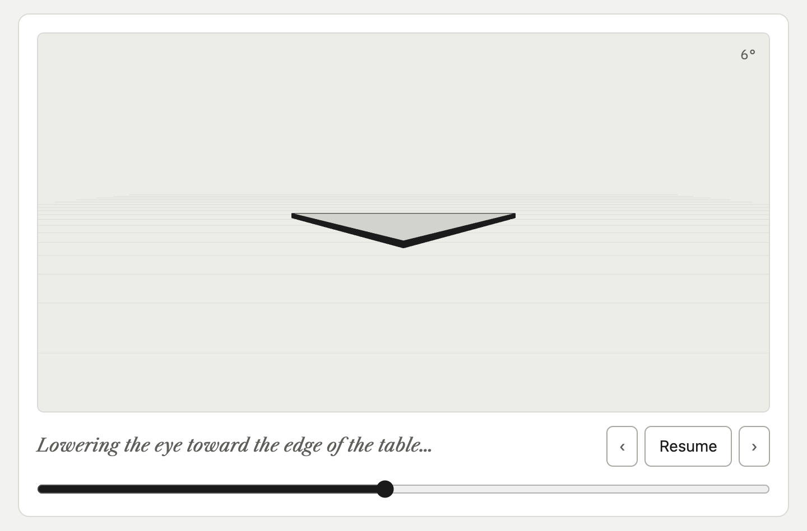
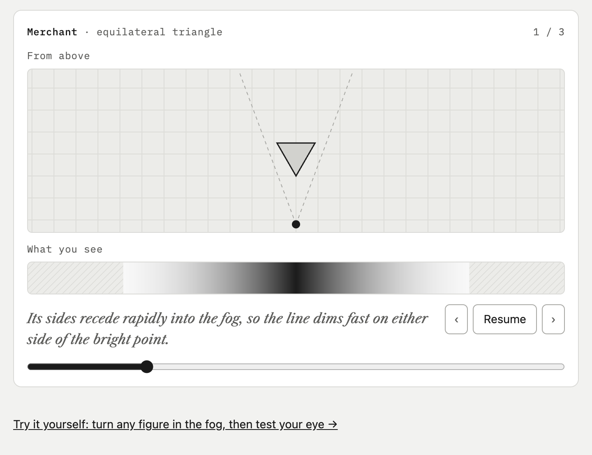
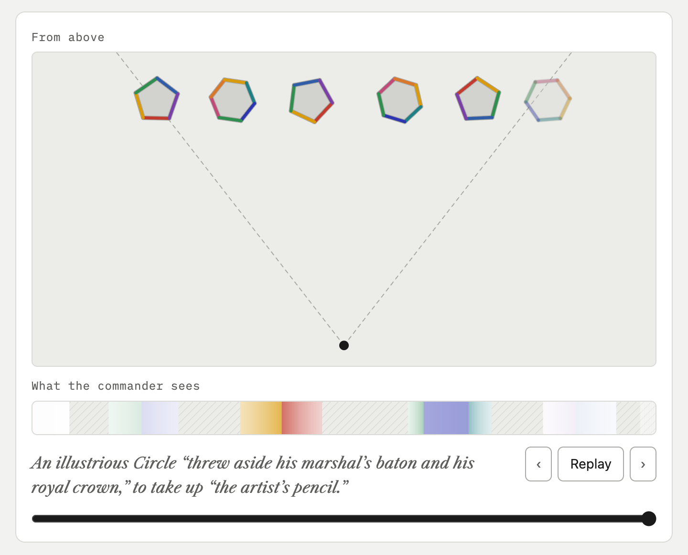
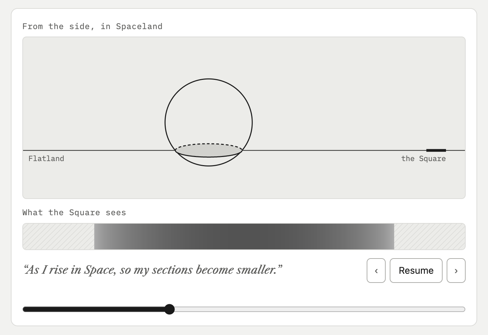
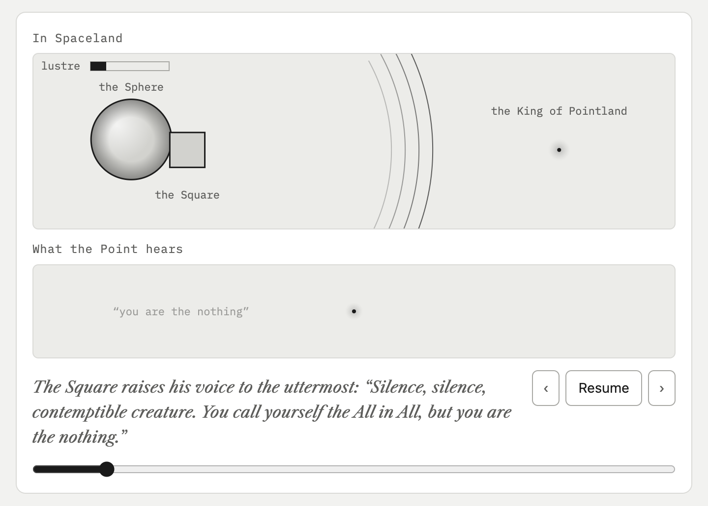

# Flatland Fog

An interactive reading of *Flatland: A Romance of Many Dimensions* (Edwin A. Abbott, 1884). The full text sits alongside working models of the book's thought experiments: lower your eye to the table until a triangle becomes a line, read a stranger's rank from the fog, watch a Sphere pass through the plane.

The site stays black and white like the book's ink plates. Colour appears for the first time in the sections about the Colour Bill (VIII to X).



| | |
|---|---|
|  |  |
| VI · Recognition by sight | VIII · The Colour Revolt |
|  |  |
| XVI · The Sphere rises out of Flatland | XX · Pointland |

## Run it

It is a static site with no build step. Serve the folder with any static server:

```bash
python3 -m http.server 8000
```

Then open <http://localhost:8000/>. Opening `index.html` straight from disk also works, apart from the interactives that load three.js from a CDN when you are offline.

## Layout

| Path | What it holds |
|---|---|
| `index.html` | Contents page |
| `read/` | One page per section: preface plus sections I to XXII |
| `interactives/` | One folder per interactive; each works on its own page and embedded in a reading page |
| `illustrations/` | The ten plates from the book, as SVG |
| `shared/` | Theme, geometry, canvas drawing, the 3D slab renderer and the play-once animation player shared by the interactives |
| `tools/import_text.py` | Regenerates `read/` and `index.html` from the Standard Ebooks source |
| `docs/PLAN.md` | Plan: which section gets which interactive, and the milestones |
| `docs/screenshots/` | The screenshots in this README, taken at a fixed moment with `?embed=1&t=<ms>` |

## Interactives

| Section | Interactive | Status |
|---|---|---|
| I | Lower your eye to the table (`coin-on-table`) | Done |
| VI | Recognition by sight (`recognition-by-sight`): the Merchant, the Physician and a hexagonal grandson walk out of the fog | Done |
| VI | The recognition game (`recognition-game`): turn any figure in the fog, then test your eye; linked from the Section VI animation | Done |
| II | Houses and rain (`house-and-rain`): a traveller waits for the rain to find the North, the roofs face it, a lady gets the North side of the way; the law removes triangular and then square houses | Done |
| III | Lineage (`lineage`): each son has one more side, up to the Circle; an Isosceles family widens its angle to 60° and the child is adopted by an Equilateral | Done |
| IV | Meeting a woman (`meeting-a-woman`): a line side on, a lustrous point eye first, a dim point from behind; in the street, the peace-cry and the swaying back | Done |
| V | Recognition by feeling (`feeling`): one felt angle tells Triangle, Square and Pentagon apart but hardly ten sides from twelve; the grandfather's accident and the family's climb back to 60° | Done |
| VII | Irregular figures (`irregular`): a figure with unequal sides must be felt corner by corner, a tradesman's parallelogram sticks fast in your door, and a man with a polygonal front passes for a gentleman until he turns; the same figure is in the recognition game | Done |
| VIII | The Colour Revolt (`colour-revolt`): Chromatistes paints himself and turns, the fashion spreads through every class but the women and the Priests, and the army passes in review in the colours the book names | Done |
| IX | The Colour Bill (`colour-bill`): painted red in front and green behind, a woman and a Priest become the same line; in colour, like the rest of Sections VIII to X | Done |
| XIII | Lineland (`lineland`): a world that is one Straight Line, where everyone sees only a Point; the King hears the Square as a voice from inside, can never pass his neighbours, and marries by voice in the weekly Marriage Chorus | Done |
| XIV, XVI | Passing through (`passing-through`): the Square steps out of Lineland, and the Sphere rises out of Flatland | Done |
| XVIII | The view from above (`view-from-above`): rise out of the plane and see into the Square's house, then the whole city | Done |
| XIX | Strictly according to Analogy (`dimension-ladder`): the Sphere stacks square cards into a Cube; then a moving point makes a line, a line a square, a square a cube, and a cube, drawn as its shadow, a figure with sixteen corners | Done |
| XX | Pointland (`pointland`): the Sphere and the Square float down to a Point whose hum carries twenty diagonals; it thinks, utters and hears only itself, and takes the Square's insults for its own thought | Done |

## Regenerating the text

```bash
git clone --depth 1 https://github.com/standardebooks/edwin-a-abbott_flatland.git /tmp/se-flatland
python3 tools/import_text.py /tmp/se-flatland
```

Which interactive appears in which section, and after which figure, is set in `EMBEDS` at the top of the script.

## Credits and licence

- Text and illustrations: the [Standard Ebooks](https://standardebooks.org/ebooks/edwin-a-abbott/flatland) edition, in the public domain; Standard Ebooks dedicates its own work under CC0 1.0.
- Site code and interactives: MIT License, see [LICENSE](LICENSE).
- 3D rendering uses [three.js](https://threejs.org/) r128 from cdnjs.
